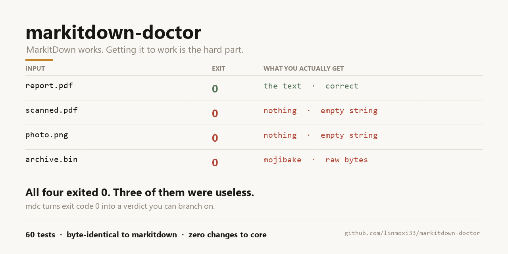

# markitdown-doctor

[](https://github.com/linmoxi33/markitdown-doctor/actions/workflows/tests.yml)
[](https://github.com/linmoxi33/markitdown-doctor/releases)
[](LICENSE)



**MarkItDown works. Getting it to work is the hard part.**

A thin diagnostic layer around [`microsoft/markitdown`](https://github.com/microsoft/markitdown) that answers three questions the original tool leaves you to guess:

1. *Which formats can this environment actually convert right now?*
2. *When a conversion fails, what exactly do I run to fix it?*
3. *When a conversion "succeeds" but produces nothing, how do I find out?*

It does not reimplement, patch or fork MarkItDown. Every conversion goes through MarkItDown's own public API, and the output is byte-for-byte identical.

---

## The problem this solves

MarkItDown is excellent at its job. Its failure modes are not about conversion quality — they are about the first ten minutes.

```console
$ pip install markitdown
$ markitdown report.pdf
Traceback (most recent call last):
  ...28 lines of traceback...
markitdown._exceptions.FileConversionException: File conversion failed after 1 attempts:
 - PdfConverter threw MissingDependencyException with message: PdfConverter recognized
   the input as a potential .pdf file, but the dependencies needed to read .pdf files
   have not been installed...
```

Four separate problems are visible in that one interaction:

| Problem | What the user experiences |
|---|---|
| A bare install cannot read PDF, DOCX, XLSX or PPTX | `pip install markitdown` succeeds, then nothing useful converts |
| No way to know before trying | You discover each missing format by triggering a traceback |
| Failures speak Python, not English | The actionable sentence is buried under 28 lines of stack |
| Empty output looks like success | A scanned PDF returns exit code 0 and an empty string |

That last one is the dangerous one. In a batch job it produces a directory of empty `.md` files that look converted, and a downstream LLM receives empty context with no error to react to.

## What this adds

```
mdc doctor              what can this environment convert right now?
mdc formats             full format table, with the pip extra for each
mdc check report.pdf    preflight files without converting them
mdc convert docs/ -r    batch convert to .md + manifest.json
```

### 1. `doctor` — the answer to "why doesn't it work"

```console
$ mdc doctor
MarkItDown environment
  python       3.13.14
  markitdown   0.1.8

Not installed
  [ ] pdf                    .pdf
  [ ] docx                   .docx
  [ ] xlsx                   .xlsx

To unlock the missing formats:
  pip install 'markitdown[pdf,docx,xlsx]'
```

The suggested command lists every extra that is missing. If you want the
narrowest command for *your* files, `mdc check` computes it from the extensions
you actually have:

```console
$ mdc check docs/
...
Unblock them with:
  pip install 'markitdown[docx,pdf]'
```

### 2. `check` — know before you convert

```console
$ mdc check documents/
UNKNOWN     documents/archive.bin
OK          documents/data.csv
MISSING DEP documents/memo.docx
            why: Word document converter is registered but its dependency is not
                 installed (missing: mammoth).
            fix: pip install 'markitdown[docx]'
MISSING DEP documents/report.pdf
            why: PDF converter is registered but its dependency is not installed
                 (missing: pdfminer, pdfplumber).
            fix: pip install 'markitdown[pdf]'

5 file(s) checked, 2 ready, 3 blocked.

Unblock them with:
  pip install 'markitdown[docx,pdf]'
```

Preflight uses only metadata reads and `importlib` probes, so it is cheap enough to run across thousands of files before a batch job starts. The closing command is computed from the extensions you actually have — not from the full list of extras.

### 3. `convert` — batch mode with a verdict per file

```console
$ mdc convert ./documents -r -o ./markdown
  junk  archive.bin  binary read as text, not written
        fix: Confirm the file is not corrupt and that its format is supported ...
  ok    data.csv -> markdown/data.md  33 chars
  ok    memo.docx -> markdown/memo.md  50 chars
  ok    report.pdf -> markdown/report.md  25 chars
  empty scan.pdf  no text extracted, not written
        fix: Run OCR first (`ocrmypdf in.pdf out.pdf`) ...

Summary: 3 converted, 1 empty, 1 junk, 0 failed, 0 skipped (of 5)
Manifest: markdown/manifest.json
```

Three behaviours worth calling out:

- **Empty results are not written by default.** An empty `.md` is worse than no `.md`, because it looks like a successful conversion. Use `--keep-empty` to override.
- **Binary fallback is caught.** MarkItDown's plain-text converter is a catch-all, so a corrupt archive comes back as mojibake with a success code. `mdc` flags that as `junk`.
- **Nothing is overwritten.** When `a.csv` and `a.html` both map to `a.md`, *both* become `a.csv.md` and `a.html.md`, rather than one silently winning.

### 4. Exit codes you can branch on

| Code | Meaning |
|---|---|
| `0` | Everything converted with content |
| `1` | Partial — some files failed, were empty, or were skipped |
| `2` | Nothing converted, or a usage problem |

---

## Install

```bash
pip install markitdown-doctor
```

This pulls in `markitdown` but **not** its format extras. That is deliberate: run `mdc doctor` first, and it will tell you exactly which extras you need.

If you already know you want everything:

```bash
pip install 'markitdown-doctor[all]'
```

Not on PyPI yet. Install straight from the repository instead:

```bash
pip install "markitdown-doctor @ git+https://github.com/linmoxi33/markitdown-doctor"
```

Or grab the wheel from the [latest release](https://github.com/linmoxi33/markitdown-doctor/releases/latest).

## First five minutes

```bash
# 1. See what works
mdc doctor

# 2. Install whatever it says is missing
pip install 'markitdown[pdf,docx]'

# 3. Confirm
mdc doctor

# 4. Convert one file
mdc convert report.pdf

# 5. Convert a folder
mdc convert ./documents -r -o ./markdown
```

## Relationship to MarkItDown

`mdc` is a wrapper, not a fork:

- Conversion always goes through `MarkItDown.convert()`; no converter logic is copied.
- Single-file stdout output is **byte-identical** to `markitdown file.pdf`, verified with `cmp`. Existing pipelines can swap the command and nothing downstream changes.
- Every extra, converter and dependency mapping in `formats.py` mirrors MarkItDown 0.1.8's own registry. When upstream changes, that file is the only thing to update.

## Known limits

- The format matrix is pinned to MarkItDown 0.1.8. A future release that adds converters will need `formats.py` updated.
- The binary-fallback check is a heuristic (control-character density). It is tuned conservatively and tested against Chinese, Japanese, Arabic, emoji, code and tab-separated text, but an unusual binary file could still slip through as text.
- `--json` output shape is stable but not yet versioned.

## License

MIT. MarkItDown itself is MIT, copyright Microsoft Corporation.
